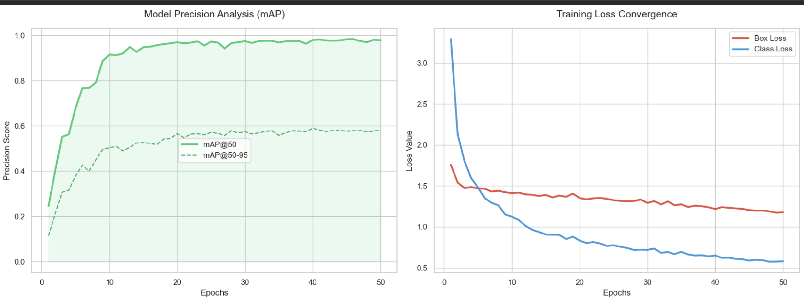
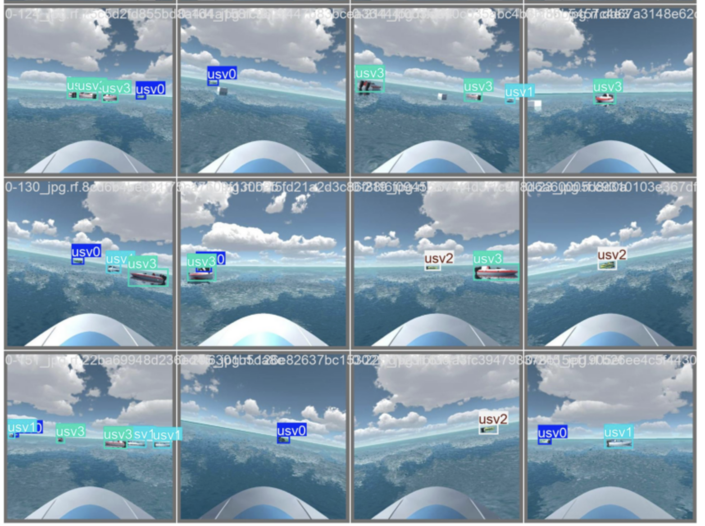
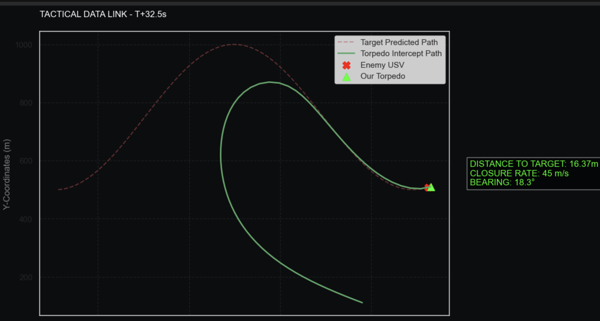

RAMH | Maritime AI & Autonomous Systems Research

Project Overview

RAMH is a multidisciplinary engineering research project exploring the application of artificial intelligence, computer vision, and autonomous systems in maritime environments.

The project combines engineering design, machine learning experimentation, system visualization, and simulation-based analysis to explore intelligent maritime monitoring concepts.

Key Areas of Work

* Computer Vision: Object detection experiments involving maritime vessels.
* Machine Learning: Model training and performance evaluation.
* AI-Based Analysis: Exploring intelligent recognition and classification.
* System Visualization: Visual representations of system concepts and simulated scenarios.
* Engineering Design: Multidisciplinary research and system-level design.

AI Model Experiments

The project includes object detection model training and evaluation.

Performance analysis includes:

* Mean Average Precision (mAP).
* Training loss convergence.
* Visual inspection of detection results.

Quantitative performance values will be documented after verification against the original evaluation results.

Project Scope

RAMH was developed as an academic engineering research project. The materials presented in this repository focus on AI experimentation, computer vision, engineering concepts, and simulation-based visualization.

This repository does not represent a deployed or operational defense system.

Team

Collaborative project developed by:

* Fatimah Abdullah
* Hanin Ali
* Rana Alanazi

Acknowledgment

We would like to thank our project supervisor, Eng. Yazeed Alharbi, for his guidance and support, as well as the Innovation Club and the faculty members who supported the project.

Skills & Technologies

* Artificial Intelligence
* Machine Learning
* Computer Vision
* Object Detection
* Autonomous Systems Research
* Engineering Design
* Simulation & Visualization
* Teamwork and Project Collaboration

Project Status

Academic research and engineering development.

⸻

RAMH — An exploration of AI and intelligent maritime systems through multidisciplinary engineering.

## Project Performance

### 1. Model Performance

### 2. Object Detection Results

### 3. System Visualization

### 4. Acoustic Analysis

### 5. Acoustic Signal

### 6. 3D System Visualization

## Physical Prototype

### Prototype Overview

### Hardware Components

## Hardware Components

The RAMH prototype documentation identifies the following hardware components:

| Component | Purpose |
|---|---|
| NVIDIA Jetson Nano | AI Processing |
| HEX Cube + Pixhawk 2 | Control System |
| Hydrophone | Sound Detection |
| Camera | Visual Detection |
| Battery (9V / Li-ion) | Power Supply |
| Motors / Thrusters | Movement |

