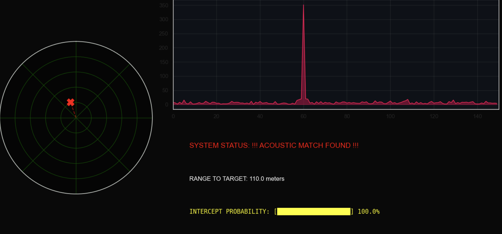
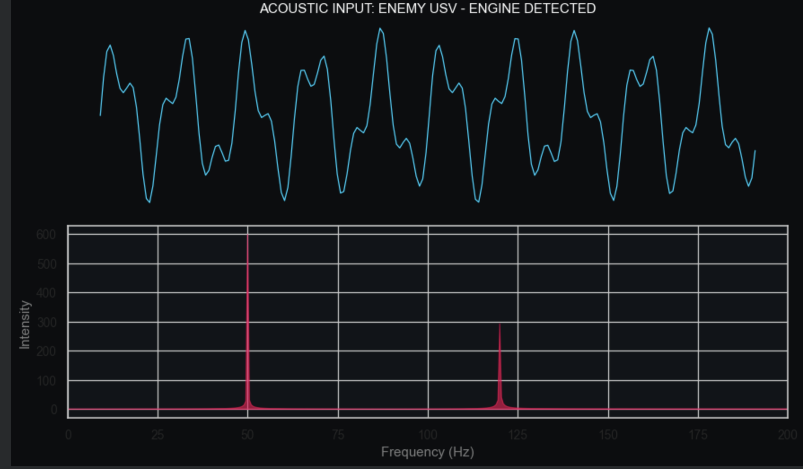
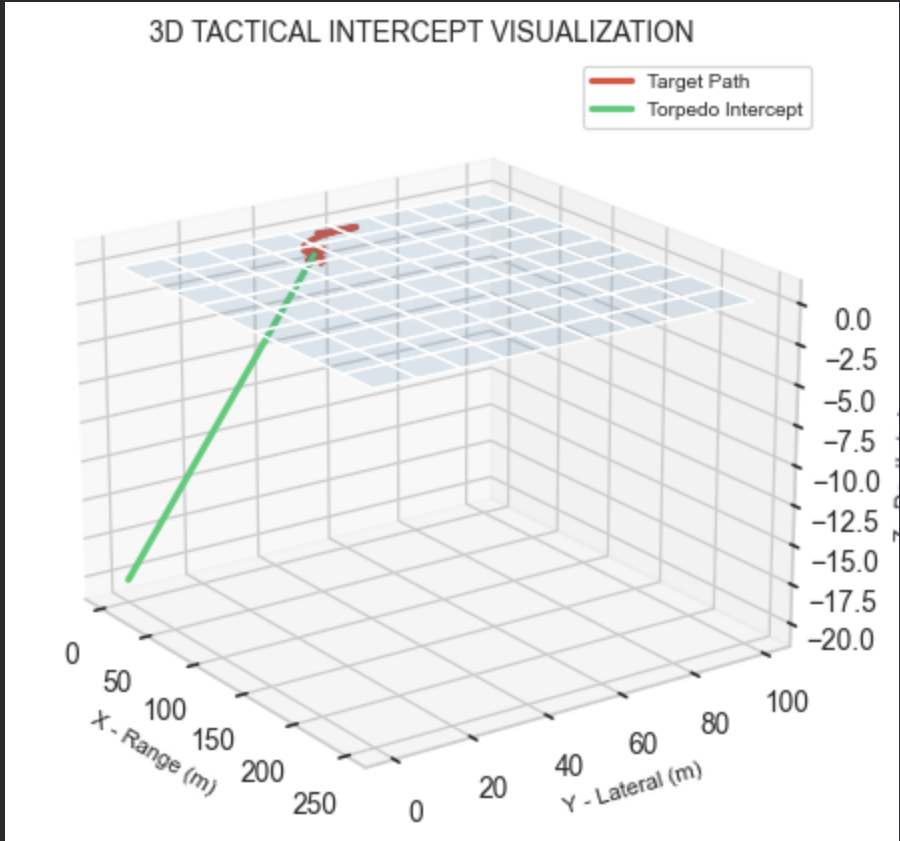
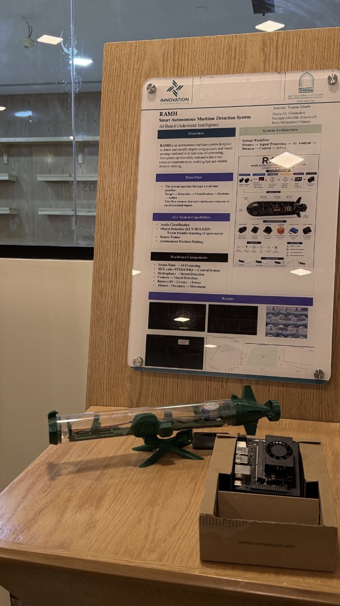
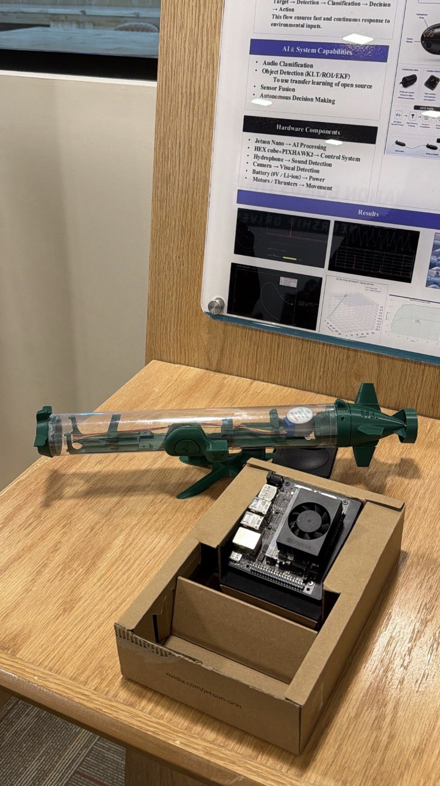

RAMH | Maritime AI & Autonomous Systems Research

Project Overview

RAMH is a multidisciplinary engineering research project exploring the application of artificial intelligence, computer vision, and autonomous systems in maritime environments.

The project combines engineering design, machine learning experimentation, system visualization, and simulation-based analysis to explore intelligent maritime monitoring concepts.

Key Areas of Work

* Computer Vision: Object detection experiments involving maritime vessels.
* Machine Learning: Model training and performance evaluation.
* AI-Based Analysis: Exploring intelligent recognition and classification.
* System Visualization: Visual representations of system concepts and simulated scenarios.
* Engineering Design: Multidisciplinary research and system-level design.

AI Model Experiments

The project includes object detection model training and evaluation.

Performance analysis includes:

* Mean Average Precision (mAP).
* Training loss convergence.
* Visual inspection of detection results.

Quantitative performance values will be documented after verification against the original evaluation results.

Project Scope

RAMH was developed as an academic engineering research project. The materials presented in this repository focus on AI experimentation, computer vision, engineering concepts, and simulation-based visualization.

This repository does not represent a deployed or operational defense system.

Team

Collaborative project developed by:

* Fatimah Abdullah
* Hanin Ali
* Rana Alanazi

Acknowledgment

We would like to thank our project supervisor, Eng. Yazeed Alharbi, for his guidance and support, as well as the Innovation Club and the faculty members who supported the project.

Skills & Technologies

* Artificial Intelligence
* Machine Learning
* Computer Vision
* Object Detection
* Autonomous Systems Research
* Engineering Design
* Simulation & Visualization
* Teamwork and Project Collaboration

Project Status

Academic research and engineering development.

⸻

RAMH — An exploration of AI and intelligent maritime systems through multidisciplinary engineering.

## Project Performance

### 1. Model Performance

### 2. Object Detection Results

### 3. System Visualization

### 4. Acoustic Analysis

### 5. Acoustic Signal

### 6. 3D System Visualization

## Physical Prototype

### Prototype Overview

### Hardware Components

## Hardware Components

The RAMH prototype documentation identifies the following hardware components:

| Component | Purpose |
|---|---|
| NVIDIA Jetson Nano | AI Processing |
| HEX Cube + Pixhawk 2 | Control System |
| Hydrophone | Sound Detection |
| Camera | Visual Detection |
| Battery (9V / Li-ion) | Power Supply |
| Motors / Thrusters | Movement |

Technology Stack

Hardware Components

* NVIDIA Jetson Nano: AI processing.
* HEX Cube + Pixhawk 2: Flight control system.
* Hydrophone: Underwater sound detection.
* Camera: Visual detection.
* Battery (9V / Li-ion): Power supply.
* Motors / Thrusters: Movement and propulsion.

Technical Areas

* Artificial Intelligence (AI)
* Machine Learning
* Computer Vision
* Object Detection
* Audio Classification
* Sensor Fusion
* System Simulation and Visualization

Note: Programming languages, frameworks, and software libraries are not listed because they have not yet been verified.

System Architecture & Workflow

The RAMH system follows an integrated processing workflow:

1. Data Acquisition: Collecting visual and acoustic data through the camera and hydrophone.
2. Signal Processing: Preparing sensor data for analysis.
3. AI Analysis: Applying object detection and audio classification techniques.
4. Target Classification: Identifying and classifying detected targets.
5. Decision Making: Processing analysis results to determine the appropriate response.
6. Control and Action: Using the control system to support the intended system response.

The workflow combines visual detection, acoustic analysis, and AI-based processing within a unified maritime monitoring concept.

Repository Structure

RAMH-Maritime-AI-Research/
│
├── README.md
│
└── images/
    ├── IMG_9631.png
    ├── IMG_9632.png
    ├── IMG_9633.png
    ├── IMG_9634.png
    ├── IMG_9635.png
    ├── IMG_9636.png
    ├── IMG_9666.jpeg
    └── IMG_9667.jpeg

The images directory contains project performance results, system visualizations, and physical prototype photographs.

